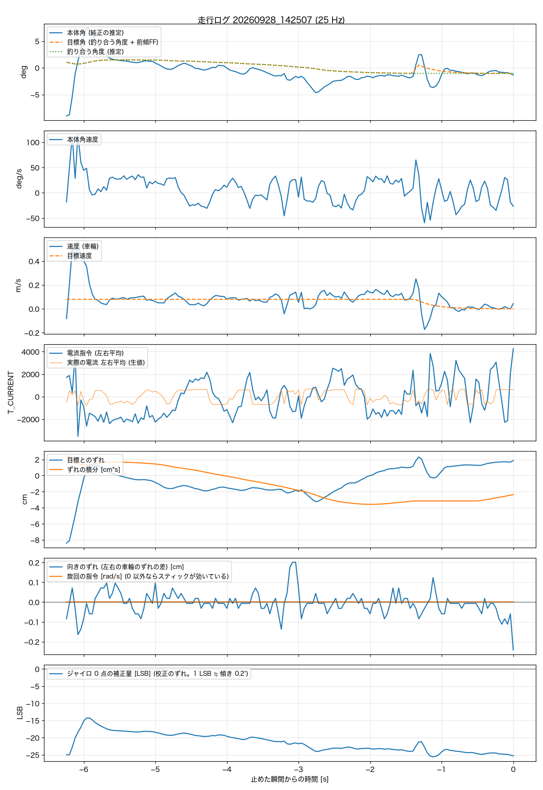

# ビュートバランサー2 の倒立制御 (倒立振子コンテスト)

京都大学のエレクトロニクスサマーキャンプ (3 回生向け) の倒立振子コンテストに向けて作った、
2 輪倒立ロボット「ビュートバランサー2」(Vstone 製、ARM Cortex-M3 / LPC1343) の制御ファームと開発ツールです。

コースは「直立 15 秒 → 直進 → S 字 → ゆるい坂 → きつい坂・シーソー」の障害物競走です。
最後の区間 E のシーソーを含め、**コースを最後まで完走できる**ところまで仕上げました
([シーソーを 3 回連続で完走したときの記録](snapshots/seesaw_v2/README.md))。



*シーソーを渡りきったときの走行ログ。上から傾き、傾く速さ、速度、電流、目標とのずれ、向きのずれ、ジャイロ 0 点の補正量。
機体から USB でログを吸い出して自動でグラフにしています。*

## やったこと

**1. 事前準備: モデルとシミュレーションでの設計** ([docs/02_制御設計.md](docs/02_制御設計.md)、[docs/04_理論.md](docs/04_理論.md))

- 取扱説明書とサンプルコードからハードの仕様を調べ、出典つきでまとめた ([docs/01_調べた事実.md](docs/01_調べた事実.md))。
  この機体には加速度センサーがなく、純正の傾き推定 (ハイパスフィルタつきのジャイロ積分) では、坂で傾いたまま釣り合う姿勢を推定できないことがわかった。
- 非線形の 2 輪倒立振子モデル (坂、シーソー、逆起電力、摩擦、センサーの量子化とドリフトを含む) のシミュレーターを Python で作った ([archive/sim/](archive/sim/))。
- カルマンフィルタ + LQI を設計し、機体パラメータを ±20〜30% ずらした 16 回の試行で比べた。
  シミュレーション上は、角度推定誤差が 10.2° → 0.18°、完走率が 81% → 100% になった。

**2. 当日: 実機に合わせて方針を切り替えた** ([docs/05_開発手順.md](docs/05_開発手順.md))

- 自作ゲインは実機では弱すぎて立たなかった。床や機体がモデルと合わなかったため。
  そこで、**純正の 4 状態フィードバックとゲインを土台にして、足りないところを足していく**方針に切り替えた。
- Mac では書き込みモードのドライブがマウントされなかったので、USB HID で直接書き込むツールを作った ([tools/flash_mac.py](tools/flash_mac.py))。
  あわせて、ビルド・書き込み・ログの吸い出し・グラフ化・ログの比較を `./bb2` の 1 コマンドにまとめた。

**3. ログを取っては直す、を 3 日で約 90 回** ([logs/](logs/))

- 走行ごとに RAM のログを吸い出し、グラフと集計で原因を探して直した。
- 機体を倒す実験のログから倒立振子のモデルを同定し、閉ループの極を計算した ([tools/sysid/](tools/sysid/))。
  純正ゲインでは 1 Hz の揺れがほとんど減衰しない (減衰比 0.06) ことがわかり、実機の「ゆっくり前後に揺れる」と合った。

## 制御の中身 (v5)

詳しくは [docs/06_処理の流れ.md](docs/06_処理の流れ.md)。コードは [firmware/main.c](firmware/main.c) です。

外側を 500 Hz の状態フィードバック、内側を 1 kHz の電流 PI 制御とするカスケード制御です。
純正の状態フィードバックに、次のものを足しました。

| 足したもの | 制御の名前 | 解決した問題 |
|---|---|---|
| S 字加減速の目標軌道 + 加速度に見合った前傾 (a/g) | 2 自由度制御 | 加速しようと前傾すると、フィードバックが起こそうとして逆らい、倒れていた |
| 車輪速度オブザーバ (20 Hz、臨界減衰) | 状態オブザーバ | エンコーダの差分が粗く (1 カウント 6.2 rad/s)、電流が ±2500 揺れていた |
| 釣り合う角度の推定 | 平衡点のオフセット推定 | スタート時の持ち方で傾きの基準がずれ、毎回走りが変わっていた |
| 走行中のジャイロ 0 点補正 | バイアス推定 | 校正の 0 点が回ごとにずれ、止まっていても前に出ていった |
| 車輪角のずれの積分 (加速中は止める) | 積分動作 + アンチワインドアップ | 坂で押し戻されたまま下がり続けていた |
| ずれの上限 2 cm (`EMAX`) | 飽和処理 | シーソーが傾いた瞬間の飛び出しを一気に取り戻そうとして、後ろに倒れていた |
| 電流制御の P ゲインを 4 倍 (`KCP`) | 内側ループの高速化 | 電流が指令に届くまで 93 ms かかり、倒れる速さ (時定数 83 ms) に追いつかなかった。4 倍で 5 ms になった |
| 純正サンプルの単位の誤りを修正 | (バグ修正) | 走行中、速度の項がブレーキとして働いていた |

調整値はすべて `make` の引数で変えられるようにして (`./bb2 flash v5 EMAX=1 KCP=4` など)、ログと見比べながら決めました。
シーソーを渡れるようになるまでの試行錯誤は [docs/06_処理の流れ.md の 6 章](docs/06_処理の流れ.md#6-シーソーを渡れるようになるまで) にあります。

## フォルダ構成

```
bb2                  開発コマンド (./bb2 help で一覧)
firmware/            実機ファーム: main.c (v5)、Makefile、リンカスクリプト、チェックサム計算
tools/               Mac 側のツール: 書き込み、ログの吸い出しとグラフ化、リアルタイム表示、電池の測定
tools/sysid/         ログからのモデル同定とゲイン設計
logs/                実機の走行ログ (CSV と PNG)。読み方は logs/README.md
snapshots/           うまくいった版の記録 (設定、ログ、メモ)
docs/                調べた事実、制御設計、理論、当日の手順、開発手順、処理の流れ
archive/sim/         事前準備のシミュレーター (カルマンフィルタ + LQI)
archive/kf_firmware/ 事前準備のファーム (実機ではゲインが弱すぎて立たなかった)
```

## 動かし方

```bash
python3 -m venv .venv && .venv/bin/pip install -r requirements.txt
./bb2 flash v5      # ビルドして書き込み (ボタンを押しながら USB を挿す)
./bb2 log           # 走行ログを吸い出してグラフにする (止めたら電源を切らずに USB を挿す)
./bb2 stats         # 最新のログ 3 本を比べる
```

ビルドには `arm-none-eabi-gcc` と、ビュートバランサー2 に付属する純正ライブラリが要ります。
純正ライブラリは Vstone の著作物なのでこのリポジトリには含めていません。置き場所は [firmware/vendor/README.md](firmware/vendor/README.md) を見てください。

## 使った技術

- C (ARM Cortex-M3、FPU なし、RAM 8 KB)、Makefile、リンカスクリプト
- Python (NumPy、SciPy、Matplotlib、hidapi / PyUSB)
- 制御: 状態フィードバック、LQR / LQI、カルマンフィルタ、状態オブザーバ、2 自由度制御、カスケード制御、システム同定
